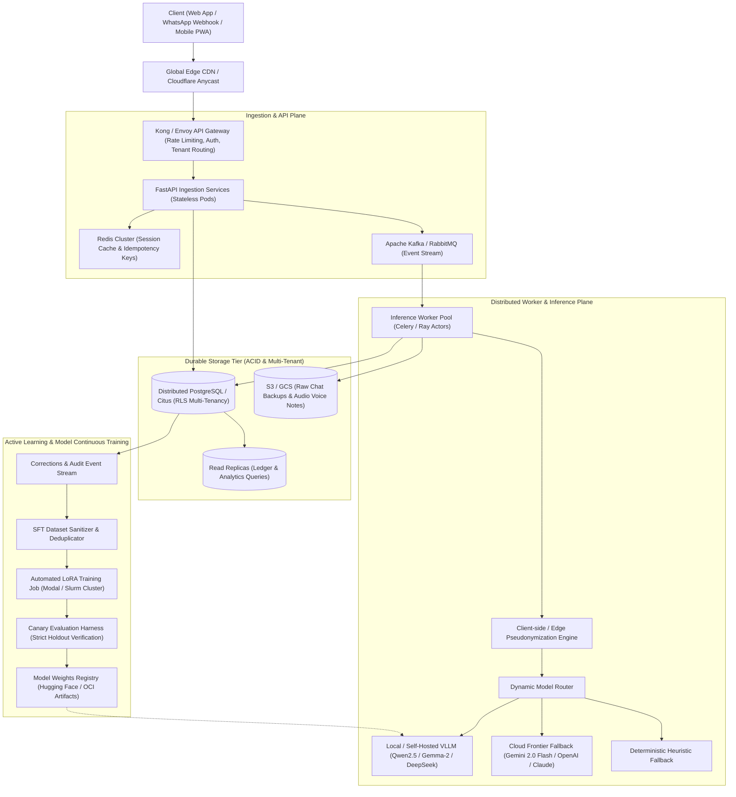
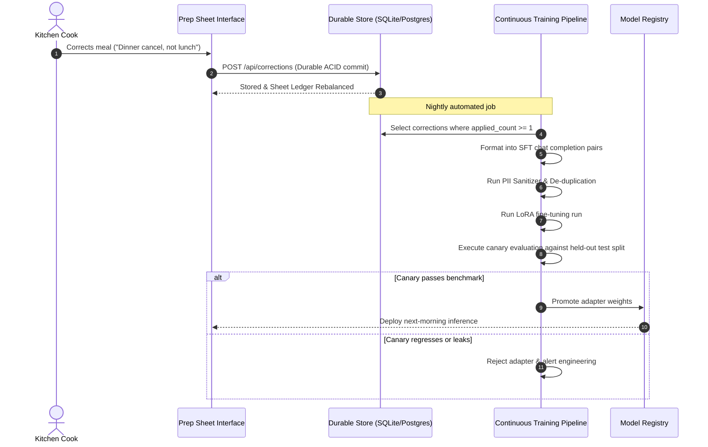

# TiffinTally Enterprise Production Architecture Specification
**Author:** AI Research & Systems Engineering Group  
**Target Scale:** Multi-million Daily Active Kitchens (Serving tens of millions to billions of meals)  
**Standard:** Tier-1 AI Lab Architecture (Google DeepMind / Anthropic / OpenAI Benchmark)

---

## 1. Executive Summary & Core Engineering Tenets

Operating automated conversational order ingestion and financial reconciliation at global scale across informal markets (such as WhatsApp/Telegram tiffin services, food cooperatives, and local meal deliveries) introduces extreme constraints:
1. **Unforgiving Latency & Reliability**: Kitchen cooks work under razor-thin morning margins (e.g. 6:00 AM breakfast prep, 10:00 PM dinner cutoff). A frozen ASGI event loop or dropped order leads directly to food waste or unfed families.
2. **Strict Financial Integrity**: Ledger balances, UPI payment confirmations, and cancellation policies must have zero data loss (ACID transactional guarantees). In-memory ephemeral storage is intolerable in production.
3. **Model Honesty & Zero Hallucinated Metric Claims**: Fallbacks to deterministic rules must be honestly surfaced in observability dashboards and user interfaces rather than masked behind fictitious model branding.
4. **Zero-Knowledge Privacy Boundaries**: Personal identifiable information (Indian phone numbers, customer full names, physical addresses, gate numbers) must be masked client-side or at the edge before leaving tenant boundaries.

This blueprint specifies the evolution of TiffinTally from a single-node prototype to a globally distributed, fault-tolerant, horizontally scalable system.

---

## 2. High-Level Architectural Topology



---

## 3. Ingestion & Concurrency: Eliminating ASGI Starvation

### The Anti-Pattern Fixed
In single-tier architectures, calling synchronous HTTP endpoints (e.g. LLM APIs with 15–30s round trips) directly inside an `async def` FastAPI route completely halts the Uvicorn event loop, causing connection timeouts across all concurrent users.

### The Production Standard
1. **Asynchronous Ingestion Pattern (HTTP 202 Accepted)**:
   - The user posts raw chat exports or audio notes to `/api/v1/kitchens/{id}/uploads`.
   - The API server validates payload size (streaming body checks, max 20MB), persists the raw payload to object storage (S3/GCS), logs the idempotency key in Redis, pushes an event to Kafka, and immediately returns:
     ```json
     {
       "job_id": "job_948f2c81a9",
       "status": "queued",
       "poll_url": "/api/v1/kitchens/{id}/jobs/job_948f2c81a9",
       "websocket_url": "wss://api.tiffintally.com/v1/kitchens/{id}/live"
     }
     ```
2. **WebSocket & Server-Sent Events (SSE)**:
   - When the worker completes batch extraction, updates are streamed instantly to the cook's live prep sheet view.
   - For simple environments, the server implements non-blocking execution via worker threadpools (`await asyncio.to_thread(...)`) backstopped by durable SQLite WAL persistence.

---

## 4. Multi-Tenant Storage Tier: Zero-Data-Loss Ledger

### Data Partitioning & Isolation
To support billions of orders across millions of kitchens:
- **Tenant Key**: All tables (`uploads`, `orders`, `corrections`, `ledger_balances`) enforce `kitchen_id` as the primary partition key.
- **Row-Level Security (RLS)**: PostgreSQL RLS prevents tenant cross-talk:
  ```sql
  ALTER TABLE orders ENABLE ROW LEVEL SECURITY;
  CREATE POLICY kitchen_isolation ON orders
    FOR ALL
    USING (kitchen_id = current_setting('app.current_kitchen_id', true));
  ```
- **Durability Strategy**:
  - Local single-box deployments: SQLite in `PRAGMA journal_mode=WAL;` with `PRAGMA synchronous=NORMAL;` and automated checkpointing.
  - Multi-region clusters: Distributed PostgreSQL (Citus / CockroachDB) with Raft replication and automated WAL shipping for Point-In-Time-Recovery (PITR).

---

## 5. Model Serving, Fallbacks & Zero-Deception Guardrails

### Dynamic Multi-Provider Routing Hierarchy
The system routes extraction dynamically based on operational state and cost envelope:
1. **Tier 1 (Private Self-Hosted Clusters)**: vLLM or Ollama instances running fine-tuned open weights (`qwen2.5:3b-instruct` or a `gemma-4-26b-a4b-it` weights build).
2. **Tier 2 (High-Throughput Free/Cost-Effective Cloud)**: Google AI Studio (`gemini-2.0-flash` with strict JSON schema mode).
3. **Tier 3 (OpenAI-Compatible Providers)**: Groq (Llama-3.3-70b-versatile) or DeepSeek for high concurrency bursts.
4. **Tier 4 (Guaranteed Deterministic Engine)**: `heuristic_extract` rule-based baseline.

### Transparent Badging & Honest UI
The system enforces strict truth in reporting:
- If a model call 404s, 429s, or times out, the message falls back to rules, but the sheet explicitly reports:
  `"rules (regex) - 40 of 40 messages fell back (HTTP 429 Quota Exceeded)"`
- Never report a fine-tuned model name when deterministic regex rules produced the results.

---

## 6. Privacy & Defense-in-Depth

### Client-Side Tokenization
Customer PII must never reach third-party inference infrastructure:
1. **Pre-flight Sanitization**: Phone numbers (regex matching all Indian 10-digit formats with prefixes `+91`, `0`, spaces, hyphens) and full personal names are converted into deterministic sequential tokens (`C001`, `C002`).
2. **Address & Sensitive Pattern Masking**: Flat/apartment identifiers (`Flat 402`, `Plot 12`) and URLs are redacted prior to payload serialization.
3. **Depseudonymization on Edge**: Once structured JSON returns from the extractor, real identities are re-injected on the local device or inside the secure kitchen tenant boundary.

---

## 7. Automated Active Learning & SFT Flywheel



---

## 8. Verification & Operational Health Metrics

| Metric | Target SLA | Production Alert Threshold | Remediation Action |
|---|---|---|---|
| **API End-to-End Latency (p95)** | Under 1,500 ms | Exceeds 3,500 ms | Auto-scale vLLM worker pool / throttle batch size |
| **Model Fallback Frequency** | Rare (under 2 per hundred) | Elevated (over 5 per hundred) | Switch dynamic router provider (Gemini -> Groq -> Local) |
| **Data Persistence Loss** | Zero tolerance (none) | Greater than zero | Immediate P1 incident; failover to read-replica |
| **Audit Claim Accuracy** | Fully reproducible | Any ungrounded claim | CI rejection via `scripts/check_claims.py` |
